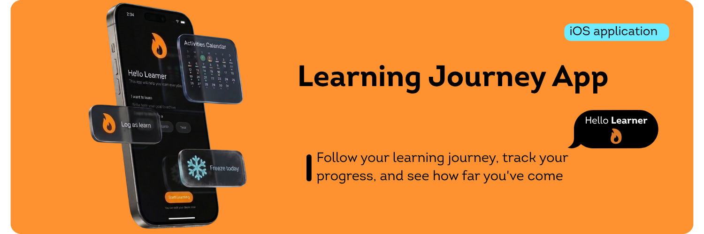

# 🔥 Learning Journey

**An iOS app that turns learning goals into a fun, motivating daily journey.**

Keep your motivation alive, build consistency, and watch your progress grow — one day at a time.

---

- 🎯 **Set Your Goal:** Define your learning goal and choose a duration.
- 📚 **Log Your Journey:** Record your daily learning activity.
- 🦸 **Become a Learning Hero:** Stay consistent and keep your flame alive.
- ❄️ **Freeze a Day:** Take planned breaks without losing your progress.
- 🔥 **Protect Your Flame:** Skip the rules, and your flame goes out!
- 📅 **Track Your Progress:** View your learning history through an interactive calendar.

---

Learning isn't about pushing yourself every single day. It's about building a healthy, balanced routine that keeps you moving toward your goals.

Learning Journey combines motivation, consistency, and flexibility to make the process more enjoyable.

---

### Architecture — MVVM

The app follows the **Model–View–ViewModel (MVVM)** pattern to separate responsibilities and keep the code maintainable.

- **Models:** `LearningGoal`, `DayLog`, `LearnState`, and `LearningDuration` represent the app's data.
- **ViewModel:** `JourneyManager` manages app state and business logic, including streaks, freezes, the 32-hour rule, and goal validation.
- **Views:** Display the current state and forward user actions to the ViewModel.

### State Management — Observation Framework

- `@Observable` enables automatic UI updates when `JourneyManager` changes.
- `@State` manages local view state.
- `@Binding` shares and updates state between components.
- `@Environment` provides shared access to the ViewModel.

### Persistence — SwiftData

- `@Model` stores learning goals and daily logs.
- Progress metrics such as streaks, freezes used, and goal status are computed from stored records rather than duplicated.
- Learning logs are preserved when a journey restarts, maintaining the full calendar history.

### Dependency Injection

- `ModelContext` is injected into `JourneyManager` through its initializer.
- A single `JourneyManager` instance is created in `MyApp` and shared through environment injection.
- The same ViewModel supports both persistent app data and temporary in-memory data for previews and tests.

### Navigation

- `RootView` determines whether to display Onboarding or Activity based on the existence of a goal.
- `NavigationStack` manages navigation to Calendar and Edit Goal screens.

### Design Principles

- **State-driven UI:** UI appearance reflects the current app state.
- **Single Responsibility:** Each type and component has a clear purpose.
- **Reusability:** Shared components such as `DayCircle`, `WeekCalendar`, `MonthCalendar`, `DurationPicker`, and `GoalSetter`.
- **DRY:** Centralized theme definitions and reusable validation logic.
- **Encapsulation:** Database operations and persistence logic are kept inside the ViewModel.
- **Defensive Programming:** Input validation, guard checks, and safe defaults prevent invalid actions.
- **Type Safety:** Enums and exhaustive switch statements replace raw strings.

---

Unit tests written with **Swift Testing** cover:

- Goal validation.
- Daily logging and state changes.
- Learn and Freeze actions.
- Freeze limits based on journey duration.
- Goal completion and the 32-hour rule.
- Journey restarts.

Each test uses a fresh in-memory database to ensure isolation from real app data.

---

- [The Swift Programming Language — Extensions](https://docs.swift.org/latest/documentation/the-swift-programming-language/extensions/)
- [Organizing Colors in iOS Projects](https://medium.com/@garejakirit/best-practices-for-organizing-colors-in-ios-projects-swiftui-uikit-guide-for-scalable-design-ea747d62c8b6)
- [Understanding Enums](https://stackoverflow.com/questions/4709175/what-are-enums-and-why-are-they-useful)
- [The Swift Programming Language — Enumerations](https://docs.swift.org/latest/documentation/the-swift-programming-language/enumerations/)
- [Choosing Between Structures and Classes](https://developer.apple.com/documentation/swift/choosing-between-structures-and-classes)

---

